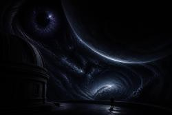
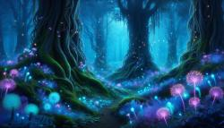
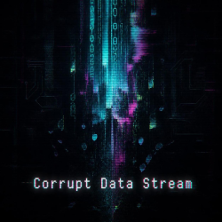

# OpenGameArt: music

**63 assets from [OpenGameArt](https://opengameart.org), dedicated to the public domain under [CC0](https://creativecommons.org/publicdomain/zero/1.0/).** Use them in any game, free or paid, and change them however you like; no credit is needed.

Music from OpenGameArt entries licensed CC0 (some also offer other licences; CC0 is the one that applies here). 905.1 MB in all.

This is a copy kept by [zuujis-cc0](https://github.com/zuujis-cc0) so game makers can take single files from GitHub. It is not made by or affiliated with OpenGameArt: the originals, often in more formats and higher resolutions, are on [opengameart.org](https://opengameart.org). If they help you, consider [supporting OpenGameArt](https://opengameart.org/content/faq).

Every file is listed in [MANIFEST.tsv](MANIFEST.tsv) with its size and SHA-256. More free assets: [the Zuujis collection](https://github.com/zuujis-cc0/free-game-assets#readme).

| | | | |
| :-: | :-: | :-: | :-: |
| <b><a href="as-fast-as-you-can">As fast as you can</a></b> by Centurion_of_war · <a href="https://opengameart.org/content/as-fast-as-you-can">source</a> | <b><a href="as-fast-as-you-can-drums-and-bass">As Fast as you Can (Drums and Bass)</a></b> by Centurion_of_war · <a href="https://opengameart.org/content/as-fast-as-you-can-drums-and-bass">source</a> |  <b><a href="astrophobia">Astrophobia</a></b> by Tsorthan Grove · <a href="https://opengameart.org/content/astrophobia">source</a> | <b><a href="attack-1">Attack!</a></b> by onehundredthousand · <a href="https://opengameart.org/content/attack-1">source</a> |
| <b><a href="aug-1-chiptunes">Aug 1 Chiptunes</a></b> by Pro Sensory · <a href="https://opengameart.org/content/aug-1-chiptunes">source</a> | <b><a href="aug-1-guitar">Aug 1 Guitar</a></b> by Pro Sensory · <a href="https://opengameart.org/content/aug-1-guitar">source</a> | <b><a href="aug-19-jazz">Aug 19 Jazz</a></b> by Pro Sensory · <a href="https://opengameart.org/content/aug-19-jazz">source</a> | <b><a href="aug-23-submission">Aug 23 submission</a></b> by Pro Sensory · <a href="https://opengameart.org/content/aug-23-submission">source</a> |
| <b><a href="aug-3-am-syntax-song">Aug 3 AM Syntax Song</a></b> by Pro Sensory · <a href="https://opengameart.org/content/aug-3-am-syntax-song">source</a> | <b><a href="awestruck">Awestruck</a></b> by isaiah658 · <a href="https://opengameart.org/content/awestruck">source</a> | <b><a href="awful-great">Awful great!</a></b> by iamoneabe · <a href="https://opengameart.org/content/awful-great">source</a> | <b><a href="backfoot">Backfoot</a></b> by Centurion_of_war · <a href="https://opengameart.org/content/backfoot">source</a> |
| <b><a href="background-drones-vol-2">Background Drones Vol 2</a></b> by Tsorthan Grove · <a href="https://opengameart.org/content/background-drones-vol-2">source</a> |  <b><a href="bamboo-blitz">Bamboo Blitz</a></b> by Tsorthan Grove · <a href="https://opengameart.org/content/bamboo-blitz">source</a> | <b><a href="banjosomething">Banjo_something</a></b> by G_P · <a href="https://opengameart.org/content/banjosomething">source</a> | <b><a href="bathing-in-the-sun">Bathing In The Sun</a></b> by Pro Sensory · <a href="https://opengameart.org/content/bathing-in-the-sun">source</a> |
| <b><a href="bathing-in-the-sun-electronic">Bathing in the sun electronic</a></b> by Pro Sensory · <a href="https://opengameart.org/content/bathing-in-the-sun-electronic">source</a> | <b><a href="before-the-world-falls-apart">Before The World Falls Apart</a></b> by Gena Sealov · <a href="https://opengameart.org/content/before-the-world-falls-apart">source</a> | <b><a href="best-modes">Best Modes</a></b> by Pro Sensory · <a href="https://opengameart.org/content/best-modes">source</a> | <b><a href="best-modes-chiptune">Best Modes Chiptune</a></b> by Pro Sensory · <a href="https://opengameart.org/content/best-modes-chiptune">source</a> |
| <b><a href="beyond-the-frozen-veil">Beyond the Frozen Veil</a></b> by Synth-thetic · <a href="https://opengameart.org/content/beyond-the-frozen-veil">source</a> | <b><a href="bicycle-0">Bicycle</a></b> by limafresh · <a href="https://opengameart.org/content/bicycle-0">source</a> |  <b><a href="biolumina">Biolumina</a></b> by Tsorthan Grove · <a href="https://opengameart.org/content/biolumina">source</a> | <b><a href="bite-sized-rpg-tunes">Bite Sized: RPG Tunes</a></b> by Guy G. Gamerson · <a href="https://opengameart.org/content/bite-sized-rpg-tunes">source</a> |
|  <b><a href="blue-moon-beach">Blue Moon Beach</a></b> by Tsorthan Grove · <a href="https://opengameart.org/content/blue-moon-beach">source</a> | <b><a href="bomba32">bomba32</a></b> by StumpyStrust · <a href="https://opengameart.org/content/bomba32">source</a> | <b><a href="bosca-song">Bosca song</a></b> by Ruhinre · <a href="https://opengameart.org/content/bosca-song">source</a> | <b><a href="boss-fight-music">BOSS fight music</a></b> by moskowa2 · <a href="https://opengameart.org/content/boss-fight-music">source</a> |
| <b><a href="bossfight-1">Bossfight_</a></b> by G_P · <a href="https://opengameart.org/content/bossfight-1">source</a> | <b><a href="bosskoto">Boss_Koto</a></b> by G_P · <a href="https://opengameart.org/content/bosskoto">source</a> | <b><a href="bossmusic2">boss_music_2</a></b> by G_P · <a href="https://opengameart.org/content/bossmusic2">source</a> | <b><a href="bosstype3">Boss_Type_3</a></b> by G_P · <a href="https://opengameart.org/content/bosstype3">source</a> |
| <b><a href="bosstype4">Boss_Type_4</a></b> by G_P · <a href="https://opengameart.org/content/bosstype4">source</a> | <b><a href="brassy-bubbles">Brassy Bubbles</a></b> by Technodono · <a href="https://opengameart.org/content/brassy-bubbles">source</a> | <b><a href="bright-eyes">Bright Eyes</a></b> by tomcat · <a href="https://opengameart.org/content/bright-eyes">source</a> | <b><a href="bright-eyes-chiptune-version">Bright Eyes (Chiptune Version)</a></b> by tomcat · <a href="https://opengameart.org/content/bright-eyes-chiptune-version">source</a> |
| <b><a href="bright-song">bright song</a></b> by haruta · <a href="https://opengameart.org/content/bright-song">source</a> | <b><a href="bright-stars">Bright Stars</a></b> by Gena Sealov · <a href="https://opengameart.org/content/bright-stars">source</a> | <b><a href="bronc">bronc</a></b> by StumpyStrust · <a href="https://opengameart.org/content/bronc">source</a> | <b><a href="bubble-2">Bubble</a></b> by Guy G. Gamerson · <a href="https://opengameart.org/content/bubble-2">source</a> |
| <b><a href="busy-but-calm-street">Busy but Calm Street</a></b> by SkyleTheFrench · <a href="https://opengameart.org/content/busy-but-calm-street">source</a> | <b><a href="c-tonal">C Tonal</a></b> by Pro Sensory · <a href="https://opengameart.org/content/c-tonal">source</a> | <b><a href="c-tonal-electronic">C Tonal Electronic</a></b> by Pro Sensory · <a href="https://opengameart.org/content/c-tonal-electronic">source</a> | <b><a href="candy-day">candy day</a></b> by haruta · <a href="https://opengameart.org/content/candy-day">source</a> |
| <b><a href="canyon-rapids-v1">Canyon Rapids (v1)</a></b> by Blengen · <a href="https://opengameart.org/content/canyon-rapids-v1">source</a> | <b><a href="castle-stage">Castle Stage</a></b> by MintoDog · <a href="https://opengameart.org/content/castle-stage">source</a> | <b><a href="catch">Catch!</a></b> by Gena Sealov · <a href="https://opengameart.org/content/catch">source</a> | <b><a href="cave-3-apr-27">cave 3 apr 27</a></b> by Pro Sensory · <a href="https://opengameart.org/content/cave-3-apr-27">source</a> |
| <b><a href="cave-apr-25">cave apr 25</a></b> by Pro Sensory · <a href="https://opengameart.org/content/cave-apr-25">source</a> | <b><a href="cavey">Cavey</a></b> by Pro Sensory · <a href="https://opengameart.org/content/cavey">source</a> | <b><a href="charge">Charge!</a></b> by Centurion_of_war · <a href="https://opengameart.org/content/charge">source</a> | <b><a href="chase-diamond-dust">Chase - Diamond Dust</a></b> by NBJDLukasAbsolute · <a href="https://opengameart.org/content/chase-diamond-dust">source</a> |
| <b><a href="chasing-excellence">Chasing Excellence</a></b> by Pro Sensory · <a href="https://opengameart.org/content/chasing-excellence">source</a> | <b><a href="chest-of-adventure">Chest of Adventure</a></b> by Eldritch Grim · <a href="https://opengameart.org/content/chest-of-adventure">source</a> | <b><a href="chill-version-nov-8">Chill version Nov 8</a></b> by Pro Sensory · <a href="https://opengameart.org/content/chill-version-nov-8">source</a> | <b><a href="chiptune-title-screen">Chiptune Title Screen</a></b> by tomcat · <a href="https://opengameart.org/content/chiptune-title-screen">source</a> |
| <b><a href="cold-0">Cold</a></b> by G_P · <a href="https://opengameart.org/content/cold-0">source</a> | <b><a href="complicated-feelings">Complicated Feelings</a></b> by Some Weirdo · <a href="https://opengameart.org/content/complicated-feelings">source</a> | <b><a href="computer-world">computer world</a></b> by haruta · <a href="https://opengameart.org/content/computer-world">source</a> |  <b><a href="confined-spaces">Confined Spaces</a></b> by Tsorthan Grove · <a href="https://opengameart.org/content/confined-spaces">source</a> |
| <b><a href="cool-adventure">Cool Adventure</a></b> by MintoDog · <a href="https://opengameart.org/content/cool-adventure">source</a> | <b><a href="cool-city">Cool City</a></b> by MintoDog · <a href="https://opengameart.org/content/cool-city">source</a> |  <b><a href="corrupt-data-stream">Corrupt Data Stream</a></b> by Tsorthan Grove · <a href="https://opengameart.org/content/corrupt-data-stream">source</a> |  |

---

Kept up to date by this repository's own [update workflow](.github/workflows/update.yml), with code and plan from [cc0-mirror](https://github.com/zuujis-cc0/cc0-mirror). Something wrong? [Open an issue there](https://github.com/zuujis-cc0/cc0-mirror/issues/new) or use the [private report form](https://games.zuujis.com/report).
